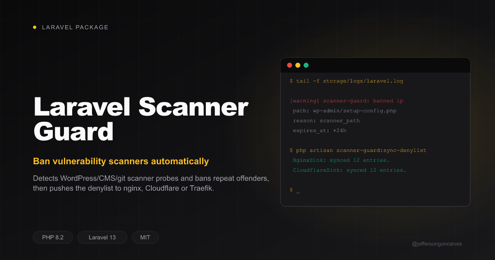

<div class="filament-hidden">



</div>

# Laravel Scanner Guard

[](https://packagist.org/packages/jeffersongoncalves/laravel-scanner-guard)
[](https://github.com/jeffersongoncalves/laravel-scanner-guard/actions?query=workflow%3ATests+branch%3Amain)
[](https://github.com/jeffersongoncalves/laravel-scanner-guard/actions?query=workflow%3A%22Fix+PHP+code+styling%22+branch%3Amain)
[](https://packagist.org/packages/jeffersongoncalves/laravel-scanner-guard)
[](LICENSE.md)

Detects and bans vulnerability-scanner traffic on Laravel apps: WordPress/CMS/credential probes,
`.git`/config leaks, phpMyAdmin, and similar noise get counted per IP and banned after a threshold,
with optional hard-blocking by ASN via
[`jeffersongoncalves/laravel-visitor-fingerprint`](https://github.com/jeffersongoncalves/laravel-visitor-fingerprint).
A SQL database is optional: bans can also live in the cache only, or be forwarded to a central app
over HMAC-signed requests (see [Running without a database](#running-without-a-database)).

## What this package does — and does not — handle

Vulnerability-scanner traffic against a Laravel app splits into two categories:

1. **Literal nonexistent `.php` files** (`/wp/index.php`, `/wordpress/index.php`, `/blog/index.php`,
   ...). These fail at the nginx/PHP-FPM layer — PHP-FPM logs "Unable to open primary script" —
   **before Laravel's front controller ever boots**. No PHP code, this package included, can see
   these requests at all. The fix lives in your nginx config, not in this package:

   ```nginx
   location ~ \.php$ {
       try_files $uri =404;
       # ... fastcgi_pass, etc.
   }
   ```

2. **Extension-less or otherwise-routable paths** that DO reach Laravel and get handled as an
   ordinary 404 by the router (`/wp-admin`, `/wp-login`, `/.git/config`, `/phpmyadmin`, `/wp-json`,
   ...). **This is what this package handles**: it counts repeat offenders per IP and bans them so
   later requests get a fast, cheap rejection instead of running through the full framework boot +
   routing + 404 view render.

If you're only seeing nginx-layer 404s (category 1) in your access logs, this package has nothing
to catch — fix `try_files` first.

## Installation

You can install the package via composer:

```bash
composer require jeffersongoncalves/laravel-scanner-guard
```

Publish the config file and run the migration:

```bash
php artisan vendor:publish --tag="scanner-guard-config"
php artisan migrate
```

The migrations are only needed for the default `database` driver — see
[Running without a database](#running-without-a-database).

## Usage

The package registers a `scanner-guard` route middleware alias but does **not** attach it to any
group automatically — opt in yourself, e.g. in `bootstrap/app.php`:

```php
use JeffersonGoncalves\ScannerGuard\Http\Middleware\BlockScannerRequests;

->withMiddleware(function (Middleware $middleware) {
    $middleware->appendToGroup('web', BlockScannerRequests::class);
})
```

or attach it to a specific route group instead:

```php
Route::middleware('scanner-guard')->group(function () {
    // ...
});
```

Once attached: a request matching one of `scanner-guard.scanner_paths` increments a per-IP hit
counter; after `ban_threshold` hits within `ban_window` seconds, the IP is banned for
`ban_duration` seconds. A banned IP gets an immediate `response_status` (404 by default —
deliberately indistinguishable from "route doesn't exist", so a scanner can't tell it got banned
and adjust its behavior).

### 404 flood

`scanner_paths` only catches software it names. To also ban scanners probing for anything else
(MediaWiki `images/thumb/...`, random `index.php/<id>` paths), opt into the 404-flood rule:

```dotenv
SCANNER_GUARD_NOT_FOUND_THRESHOLD=20
SCANNER_GUARD_NOT_FOUND_WINDOW=60
```

An IP that gets `not_found_threshold` 404 responses within `not_found_window` seconds is banned
with reason `not_found_flood`. The 404 that trips it is served normally; the ban applies from the
next request. Only 404s produced by routes the middleware runs on are counted. To count unmatched
URLs too, attach it globally or add a catch-all route. `Route::fallback()` only matches GET/HEAD
(other methods to an unknown URL get a 405 and aren't counted), so for every method use:

```php
Route::any('{any}', fn () => abort(404))->where('any', '.*')->fallback()->middleware('scanner-guard');
```

### Escalating bans for repeat offenders

By default every ban lasts `ban_duration`, so a scanner that comes back the day after its ban
expires just gets another day. Opt into an escalation ladder (seconds per offense; the last step
repeats):

```php
// config/scanner-guard.php
'escalation' => [86400, 604800, 1209600, 2592000, 7776000], // 1d → 7d → 14d → 30d → 90d
'escalation_lookback_days' => 365, // env SCANNER_GUARD_ESCALATION_LOOKBACK_DAYS
'escalation_reasons' => [ScannerGuardBan::REASON_SCANNER_PATH, ScannerGuardBan::REASON_NOT_FOUND_FLOOD, ScannerGuardBan::REASON_USER_AGENT],
```

A ban is offense N+1 when the same IP had a ban numbered N for one of `escalation_reasons` within
`escalation_lookback_days`. Reasons outside that list (e.g. `asn_blocklist`) keep `ban_duration`
and don't count as prior offenses. The offense number is stored on the ban row (`offense`) and
logged with the ban.

- **`database`**: run the `add_offense_to_scanner_guard_bans_table` migration (published with the
  others; existing installs: re-publish and `php artisan migrate`).
- **`cache` / `http`**: the count lives in a cache entry (`scanner-guard:offenses:{hash}`, TTL =
  lookback), so a cache flush resets it to the first step. With `http`, the satellite decides the
  escalation and forwards `offense` and `expires_at`; the central app stores them as-is.

> **Retention:** with escalation on, `aggregate-and-prune` keeps each IP's latest escalated ban
> inside the lookback (older/duplicate expired rows are still purged), and prunes only rows past
> `max(retention_days, escalation_lookback_days)`. Without that row the next ban would start over at
> the first step — so this is why ban rows can outlive `retention_days`.

### ASN blocklisting

Some traffic is worth blocking outright, no path match needed. A production analysis of this
package's own author's site found a single ASN (`AS16276`, OVH SAS) responsible for 70-80% of all
bot traffic with zero legitimate human visitors ever coming from it. Opt in per-app:

```php
// config/scanner-guard.php
'asn_blocklist' => ['AS16276'],
```

ASN resolution is delegated to `jeffersongoncalves/laravel-visitor-fingerprint`'s `GeoIpDriver` —
only the `ip_api` and `maxmind` drivers populate an ASN (the default `headers` driver doesn't), so
set `visitor-fingerprint.geoip.driver` accordingly for this to have any effect. When the blocklist
is empty (the default), the GeoIP driver is never even resolved — zero added latency/cost.

### IP / CIDR blocklisting

For IPs or ranges you've already identified (e.g. from Cloudflare analytics), no GeoIP needed:

```php
// config/scanner-guard.php
'ip_blocklist' => ['185.177.72.69', '185.177.72.0/24', '2001:db8::/32'],
```

Matching requests get `response_status` before any counting, checked with
`Symfony\Component\HttpFoundation\IpUtils::checkIp()` (IPv4 + IPv6). These are not bans: no row is
written and they never expire. Every [denylist sink](#blocking-before-php-denylist-sinks) always
gets them (reason `static`), so with a sink configured they never reach PHP at all. Invalid entries
are skipped before the sync (with a logged warning), so a typo can't break `nginx -t`.

### User-Agent blocklisting

Opt-in, empty by default. Catches scripted clients and blank User-Agents regardless of path:

```php
// config/scanner-guard.php
'user_agent_blocklist' => [
    'block_empty' => true, // env SCANNER_GUARD_BLOCK_EMPTY_USER_AGENT
    'patterns' => ['zgrab*', '*masscan*', 'python-requests/*'],
    'action' => 'ban', // or 'reject'; env SCANNER_GUARD_USER_AGENT_ACTION
],
```

Patterns are `fnmatch()`-style, case-insensitive, matched against the full UA string **as-is**:
nothing exempts verified crawlers, and a broad pattern such as `*curl*` also locks out your own
scripts, uptime monitors and health checks. `ban` (default) rejects and records a ban with reason
`user_agent` (stored with the matched pattern, or `empty`), so it escalates, shows up in the daily
stats and reaches the denylist sinks like any other ban; `reject` only answers with
`response_status`, nothing recorded.

### Runtime blocklist (database)

With the `database` driver, IPs / CIDR ranges and UA patterns can also live in the
`scanner_guard_blocklist` table (run the `create_scanner_guard_blocklist_table` migration), so they
change without a config edit or a redeploy. They are added on top of `ip_blocklist` and
`user_agent_blocklist.patterns`, which keep applying:

```php
use JeffersonGoncalves\ScannerGuard\Models\ScannerGuardBlocklistEntry;

ScannerGuardBlocklistEntry::query()->create(['type' => ScannerGuardBlocklistEntry::TYPE_IP, 'value' => '185.177.72.0/24', 'note' => 'Cloudflare report']);
ScannerGuardBlocklistEntry::query()->create(['type' => ScannerGuardBlocklistEntry::TYPE_USER_AGENT, 'value' => '*masscan*']);
```

The rows are cached in the scanner-guard store under a version key, so a check costs two cache
reads and no query. Saving or deleting a model, once its transaction commits, moves to a new
version (the next check, in any web, queue or Octane worker, sees the change) and, with `sinks`
configured, queues a denylist sync (`sync_on_ban` only gates syncs on new bans). A rolled-back
change does neither. A mass `query()->delete()` / `update()` fires no model events: call
`ScannerGuard::blocklistChanged()` after one. If the table is missing, the config lists still apply
and the error is reported.

The migration skips creating the table when it already exists, so apps that ran the one from
`filament-scanner-guard` keep their rows. For the same reason, rolling it back keeps the table.

### Unbanning

```php
use JeffersonGoncalves\ScannerGuard\Facades\ScannerGuard;

ScannerGuard::unban($ban->ip_hash); // number of active ban rows deleted
```

Deleting the ban row alone isn't enough: the cached ban would keep answering "banned" until it
expires. `unban()` deletes the active rows for that hash (`database` driver), forgets the cached ban
and its raw IP, and with `sinks` configured queues a denylist sync. A failing sync dispatch is
logged, never thrown.

### Manual review

With the default `database` driver, every ban writes a row to `scanner_guard_bans` (`reason`,
`matched_value`, `hit_count`, `banned_at`, `expires_at`) — a permanent, privacy-safe audit trail
(with the `http` driver, it lives on the central app):

```php
use JeffersonGoncalves\ScannerGuard\Models\ScannerGuardBan;

ScannerGuardBan::query()->active()->latest('banned_at')->get();
```

### Blocking before PHP: denylist sinks

The middleware answers banned IPs from the cache, but each request still boots PHP. A **sink**
pushes the current denylist to something that blocks earlier. Sinks ship as separate packages:

| Package | Blocks at | How |
|---|---|---|
| [`laravel-scanner-guard-nginx`](https://github.com/jeffersongoncalves/laravel-scanner-guard-nginx) | nginx | writes an `include`d `deny <ip>;` file, then reloads nginx |
| [`laravel-scanner-guard-cloudflare`](https://github.com/jeffersongoncalves/laravel-scanner-guard-cloudflare) | Cloudflare edge | replaces a Custom IP List used by a WAF rule |
| [`laravel-scanner-guard-traefik`](https://github.com/jeffersongoncalves/laravel-scanner-guard-traefik) | Traefik | serves the list to Traefik's HTTP provider (pulled, not a sink) |

Install one, then list its class:

```php
// config/scanner-guard.php
'sinks' => [
    \JeffersonGoncalves\ScannerGuardNginx\NginxSink::class,
    \JeffersonGoncalves\ScannerGuardCloudflare\CloudflareSink::class,
],
```

`php artisan scanner-guard:sync-denylist` then pushes every valid `ip_blocklist` entry (reason
`static`, no expiry) plus one entry per actively banned IP (latest expiry) to each sink. With
`sinks` non-empty it self-schedules every minute, so expired bans drop off; sinks skip the write
when nothing changed. Every new ban (local or forwarded) also queues a unique `SyncDenylist` job
(`scanner-guard.sync_on_ban`, env `SCANNER_GUARD_SYNC_ON_BAN`, default `true`), so sinks follow the
ban table within seconds; a burst of bans collapses into one sync. `unban()` and runtime blocklist
changes always queue one. Every sync runs under one cache lock (`scanner-guard.store`), so a slower
sync never overwrites a newer snapshot. A failing sink is logged and the command exits non-zero, but
the other sinks still run.

Writing your own: implement `JeffersonGoncalves\ScannerGuard\Contracts\DenylistSink`.

```php
use JeffersonGoncalves\ScannerGuard\Contracts\DenylistSink;

class MyFirewallSink implements DenylistSink
{
    /** @param list<array{ip: string, reason: string, expires_at: string|null}> $entries */
    public function sync(array $entries): void
    {
        // Replace the whole remote list with $entries. Throw on failure.
    }
}
```

`ScannerGuard::denylistEntries()` returns the same list, for consumers that pull instead of being
pushed to (that's how the Traefik package works).

### Aggregating and pruning

Every ban bumps a `scanner_guard_ban_daily_stats` row for the day it was **created** (`bans_count`,
`hits_total`, `reason_stats`, `top_matched_values` — aggregate columns only, no per-IP data). The
history is recorded at ban time, so it survives any later delete of the ban row: purge, unban or
retention prune.

`scanner-guard:aggregate-and-prune` then, in order:

1. reconciles every day from the oldest remaining ban up to yesterday against the ban rows still
   present — filling days the ban-time counter missed, never lowering a counter (`max(existing,
   recomputed)`, since deleted rows can't be recounted);
2. purges expired bans once their day is recorded, after `scanner-guard.purge_expired_after_days`
   (default `0` = next run; `null` disables);
3. deletes ban rows expired more than `scanner-guard.retention_days` (default 90) ago.

Still-active bans are never purged or pruned. With [escalation](#escalating-bans-for-repeat-offenders)
on, each IP's latest escalated ban inside the lookback is kept too.

```bash
php artisan scanner-guard:aggregate-and-prune
# reconcile from a specific day:
php artisan scanner-guard:aggregate-and-prune --date=2026-01-15
# overwrite the stats from the remaining ban rows instead of keeping the higher value:
php artisan scanner-guard:aggregate-and-prune --rebuild
```

Read the history (one entry per day, zero-filled, today live):

```php
ScannerGuard::dailyStats(14); // Collection of ['date', 'bans_count', 'hits_total', 'reason_stats', 'top_matched_values']
```

> **Upgrading:** releases before this change keyed stats rows by the day a ban *expired* (one day
> late with the default `ban_duration`). Run `php artisan scanner-guard:aggregate-and-prune --rebuild`
> once right after upgrading — before the scheduled run purges the expired rows — to rebuild those
> days by `banned_at`.

Self-schedules daily unless you opt out via `scanner-guard.auto_prune = false` (env
`SCANNER_GUARD_AUTO_PRUNE`) — on by default, since (unlike the denylist sinks) writing to the DB has no
deployment-specific footgun.

#### Privacy tradeoff

`scanner_guard_bans` only ever stores a salted hash of the IP (`ip_hash`, via
`jeffersongoncalves/laravel-visitor-fingerprint`'s `IpAnonymizer::hash()`) — never the raw address,
matching this ecosystem's other packages (`laravel-page-visits`, `laravel-short-url`). A hash can't
be reversed back into an IP, which is exactly the point — but an nginx `deny` line or a Cloudflare
list item needs a real IP.

The chosen tradeoff: at ban time, the raw IP is cached separately (keyed by the same hash, TTL =
`ban_duration`) — **cache only, never the permanent table**. `ScannerGuard::denylistEntries()` reads
active bans from the database, then looks up each one's raw IP in that cache entry. If the cache
entry has expired or been evicted (a `cache:clear`, an "array" driver that doesn't survive between
requests, LRU eviction under memory pressure, ...), that ban is silently left out of the sinks until
the IP comes back: a banned request whose raw IP is missing caches it again until the ban expires and
re-syncs the sinks (`database` driver, at most one lookup a minute per IP).

This means: the **database never contains a reversible IP**, and the **app-layer ban still applies
correctly regardless** (the fast-path/DB-fallback ban check in `isBanned()` only ever needs the
hash). The sinks are best-effort and may miss entries after a cache flush. If you rely on them,
prefer a durable cache store (`redis`, `file`) over `array` via
`scanner-guard.store`.

### Running without a database

Hit counting and the ban fast-path always run on the cache store; only the audit trail, daily
stats and the `isBanned()` DB fallback need SQL. Pick where bans go with
`scanner-guard.driver` (env `SCANNER_GUARD_DRIVER`):

| Driver | Bans stored in | Audit trail / stats | Denylist sinks | Needs migrations |
|---|---|---|---|---|
| `database` (default) | cache + `scanner_guard_bans` | yes | yes | yes |
| `http` | cache, forwarded to a central app | on the central app | from the last pull | no |
| `cache` | cache only, TTL = `ban_duration` | no | no | no |

With `http` or `cache`, a ban doesn't survive a cache flush, `ScannerGuard::ban()` returns `null`,
and `aggregate-and-prune` is neither scheduled nor run (it prints a skip notice);
`sync-denylist` only runs on `http` satellites, after each pull.

#### `http`: one central app for many satellites

On each satellite (no database):

```dotenv
SCANNER_GUARD_DRIVER=http
SCANNER_GUARD_HTTP_URL=https://central.example.com/scanner-guard/bans
SCANNER_GUARD_HTTP_SECRET=a-long-random-shared-secret
# optional, names this app in the central ban table (default: APP_NAME):
SCANNER_GUARD_HTTP_SOURCE=shop
```

On the central app (`database` driver, migrations run, including `add_source_to_scanner_guard_bans_table`):

```dotenv
SCANNER_GUARD_HTTP_SERVER_ENABLED=true
SCANNER_GUARD_HTTP_SECRET=a-long-random-shared-secret
# optional, default scanner-guard/bans:
SCANNER_GUARD_HTTP_SERVER_PATH=scanner-guard/bans
```

Each ban is POSTed as JSON (`ip`, `reason`, `matched_value`, `hit_count`, `path`, `banned_at`,
`expires_at`, `offense`, `source`) with `X-Timestamp` and `X-Signature: hash_hmac('sha256', timestamp.body, secret)`.
The central app rejects bad signatures and timestamps outside `http.tolerance` (default 300s) with
`403`, and a replayed signature with `409`. It then records the ban exactly like a local one: its
own salted `ip_hash` in the table, daily stats, and the raw IP in cache only — so its denylist
sinks cover every satellite.

`source` lands in the ban's `source` column, so you can tell which app each ban came from
(`ScannerGuardBan::where('source', 'shop')`); bans made by the central app itself have `source`
`null`. With one shared secret any satellite can claim any name. To make the name trustworthy,
give each satellite its own secret and list them on the central app:

```php
// config/scanner-guard.php (central app)
'http' => [
    'secret' => null, // null = only the sources below are accepted
    'secrets' => [
        'shop' => env('SCANNER_GUARD_SECRET_SHOP'),
        'blog' => env('SCANNER_GUARD_SECRET_BLOG'),
    ],
    // ...
],
```

A listed source is rejected with `403` unless signed with its own secret. Unlisted sources fall
back to `http.secret`, so you can move satellites over one at a time.

The satellite sends the request after the response (`defer()`), with `http.timeout` (default 2s);
a failure is logged and never affects the request or the local (cache) ban.

#### Distributing the central denylist to satellites

By default a satellite only knows its own bans. To block an IP on every app once any app (or the
central one) bans it, turn on pulling on each satellite:

```dotenv
SCANNER_GUARD_HTTP_PULL=true
```

`scanner-guard:pull-denylist` then runs every minute: a signed `GET` on `SCANNER_GUARD_HTTP_URL`
(headers `X-Source`, `X-Timestamp`, `X-Signature: hash_hmac('sha256', timestamp.source, secret)`,
same secrets as the forwarding) returns the central app's active bans, `ip_blocklist` and
user-agent patterns, including its runtime (database) blocklist. The satellite:

- caches each ban until its expiry, so the middleware blocks it;
- merges the static lists into its own `ip_blocklist` / user-agent patterns;
- lifts bans the central app no longer lists (e.g. unbanned there);
- with `sinks` configured, re-syncs its own sinks after each pull (the satellite has no database,
  so this replaces the scheduled sync).

A failed pull is logged, exits non-zero and keeps the last list. The response carries raw IPs and
isn't signed itself, so use an `https` URL. Only bans whose raw IP is still in the central cache
are served (see [Privacy tradeoff](#privacy-tradeoff)).

#### Server agents (SSH and other logs)

[`scanner-guard-agent`](https://github.com/jeffersongoncalves/scanner-guard-agent) is a static Go
binary for Linux servers. It watches sshd, nginx, postfix or any log with an IP, bans offenders in
nftables, and talks to the central app like a satellite: it forwards each ban (`reason` = its rule
name, e.g. `ssh_bruteforce`, `source` = the server name) and pulls the denylist. Give each server
its own secret in `http.secrets`.

It also sends a signed heartbeat every pull to `POST {http.server.path}/heartbeat`. The central
app keeps one row per source in `scanner_guard_agents` (run the `create_scanner_guard_agents_table`
migration), with `version`, `rules`, `active_bans`, `started_at` and `last_seen_at`:

```php
use JeffersonGoncalves\ScannerGuard\Models\ScannerGuardAgent;

ScannerGuardAgent::query()->offline()->get();     // no heartbeat for 5 minutes
ScannerGuardAgent::query()->online(120)->count(); // custom threshold, in seconds
$agent->isOnline();
```

The heartbeat is checked like a forwarded ban (signature, timestamp tolerance, replay), and its body
is validated before it is stored.

## Configuration

```php
// config/scanner-guard.php
return [
    'enabled' => true,
    'driver' => 'database', // database | http | cache
    'http' => [
        'url' => null,
        'secret' => null,
        'timeout' => 2,
        'tolerance' => 300,
        'server' => ['enabled' => false, 'path' => 'scanner-guard/bans'],
    ],
    'table' => 'scanner_guard_bans',
    'scanner_paths' => [
        'wp-admin*', 'wp-login*', 'xmlrpc.php', '*.git/config', '*phpmyadmin*', /* ... */
    ],
    'ban_threshold' => 3,
    'ban_window' => 300,
    'ban_duration' => 86400,
    'escalation' => [], // e.g. [86400, 604800, 1209600, 2592000, 7776000]
    'escalation_lookback_days' => 365,
    'escalation_reasons' => ['scanner_path', 'not_found_flood', 'user_agent'],
    'not_found_threshold' => null,
    'not_found_window' => 60,
    'asn_blocklist' => [],
    'ip_blocklist' => [],
    'user_agent_blocklist' => ['block_empty' => false, 'patterns' => [], 'action' => 'ban'],
    'store' => null,
    'response_status' => 404,
    'sinks' => [], // DenylistSink classes, see "Blocking before PHP"
    'sync_on_ban' => true,
    'daily_stats_table' => 'scanner_guard_ban_daily_stats',
    'retention_days' => 90,
    'purge_expired_after_days' => 0,
    'auto_prune' => true,
];
```

`scanner_paths` accepts `fnmatch()`-style wildcards matched case-insensitively against the request
path (no leading slash) — extend the array freely for paths specific to your own app.

## Testing

```bash
composer test
```

## Changelog

Please see [CHANGELOG](CHANGELOG.md) for more information on what has changed recently.

## Contributing

Please see [CONTRIBUTING](CONTRIBUTING.md) for details.

## Security

If you discover any security related issues, please email the author instead of using the issue tracker.

## Credits

- [Jefferson Gonçalves](https://github.com/jeffersongoncalves)
- [All Contributors](../../contributors)

## License

The MIT License (MIT). Please see [License File](LICENSE.md) for more information.
